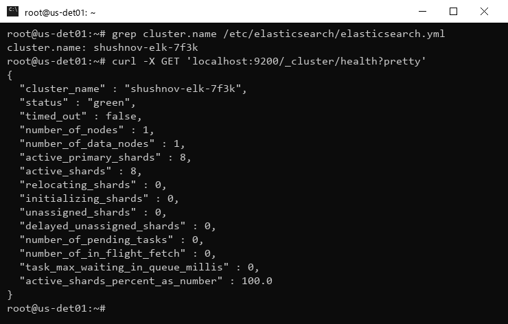
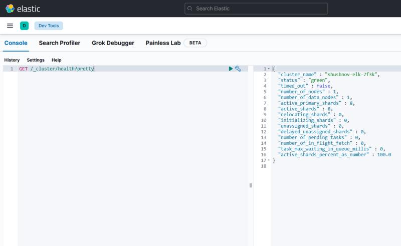

# Домашнее задание к занятию «ELK»

### Выполнил: Шушнов Александр

---

## Стенд

| Параметр | Значение |
| --- | --- |
| ОС | Ubuntu 24.04.4 LTS (VPS, 2 vCPU / 2 ГБ RAM + 4 ГБ swap) |
| Elasticsearch | 7.17.29 |
| Kibana | 7.17.29 |

Все компоненты установлены из официального apt-репозитория Elastic (`https://artifacts.elastic.co/packages/7.x/apt`).
Так как памяти на сервере немного, heap Elasticsearch ограничен 512 МБ (`/etc/elasticsearch/jvm.options.d/heap.options`).

---

## Задание 1. Elasticsearch

Конфиг `/etc/elasticsearch/elasticsearch.yml`:

```yaml
cluster.name: shushnov-elk-7f3k
node.name: us-det01
path.data: /var/lib/elasticsearch
path.logs: /var/log/elasticsearch
network.host: 127.0.0.1
http.port: 9200
discovery.type: single-node
xpack.security.enabled: false
```

```bash
systemctl enable --now elasticsearch
curl -X GET 'localhost:9200/_cluster/health?pretty'
```



---

## Задание 2. Kibana

Конфиг `/etc/kibana/kibana.yml`:

```yaml
server.port: 5601
server.host: "0.0.0.0"
server.name: "us-det01"
elasticsearch.hosts: ["http://127.0.0.1:9200"]
```

Запрос `GET /_cluster/health?pretty` в консоли `http://66.187.7.57:5601/app/dev_tools#/console`:


